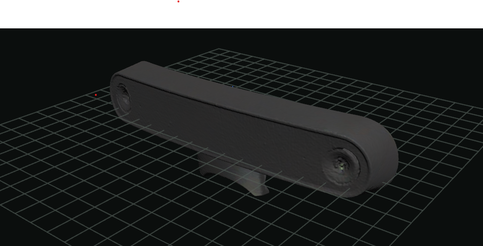

# 3D Scan of Arcturus Camera for Steam Frame

Scan I captured using a Creality CR-Scan Raptor handheld scanner. Missing the portion between the connector body and the main shell but should be straightforward to fill in. Provided as a reference for other designs, enclosures, mods, etc...

Scan has been aligned (using a dirty vibe-coded app I threw together) and simplified using [Instant Meshes](https://github.com/wjakob/instant-meshes) to reduce vertex count.

An additional `ArcturusCamera-references.obj` file contains some reference geometry for the curve of the front/back of the module. For reference the external face has a radius of about 190 mm, the inner face (mating with the frame) about 120 mm.

Texture file provided but UV mapping left as an exercise for the reader.
